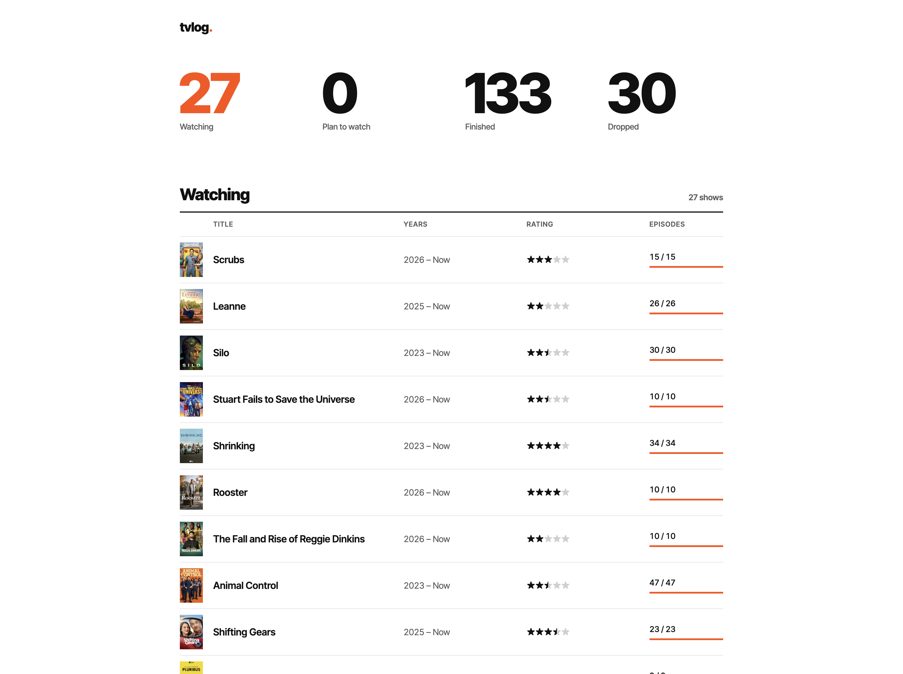
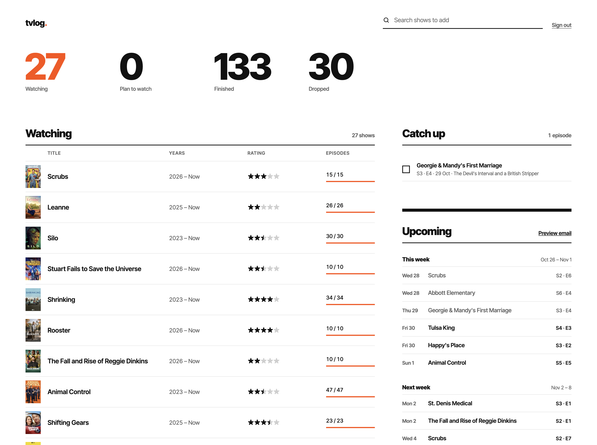
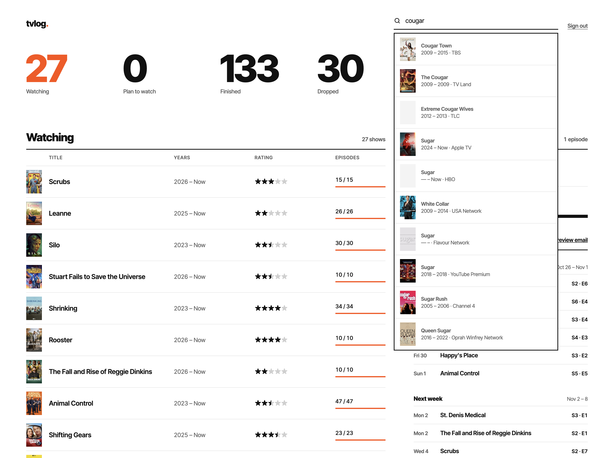
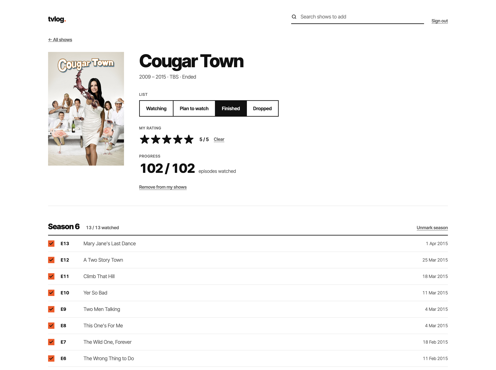

# tvlog









A small, good-looking TV tracker you host yourself for free. Keep track of what you're watching, tick off episodes,
rate shows, see what's airing next, and get a weekly email of the coming week's episodes. It all runs on the
Cloudflare free plan as a single Worker, with no server to look after.

**See it live:** [tvlog.fun](https://tvlog.fun/) is a real tvlog install. As a
visitor you see the four lists; the owner signs in to get Catch up, Upcoming and editing.

## What it can do

- **Four lists:** Watching, Plan to watch, Finished and Dropped, each with its total at the top.
- **Search and add shows** by name. Show data, posters and episode lists come from [TVmaze](https://www.tvmaze.com/api),
  which is free and needs no API key.
- **Episode tracking.** Tick an episode and every earlier one is ticked too. Each season has a "mark all" button.
  Counts like `20 / 25` only count episodes that have already aired.
- **Smart moves.** Start watching a Plan to watch show and it moves to Watching. Finish every episode of a show that
  has ended and it moves to Finished. Move a show to Finished and every aired episode is marked watched.
- **Half-star ratings** out of 5, editable right on the homepage.
- **Catch up:** every aired episode of your Watching shows that you haven't seen yet, ready to tick off.
- **Upcoming:** the next four weeks of episodes from your Watching shows, grouped by week.
- **Weekly email (optional):** the coming week's episodes in a clean email, sent through Brevo on the day and time
  you pick. There's a preview of the next email, with a gear icon to change when it's sent.
- **Anyone can look, only you can edit.** Visitors see your lists. You sign in with a password to change things.
  Sign-in locks for 15 minutes after 10 wrong passwords.
- **Keeps itself up to date.** Once a day it re-downloads shows that changed on TVmaze, so new episodes and air
  dates show up on their own.
- Works on phones, and sets up its own database tables the first time it runs.

## What you need

| What | Cost | Needed? | What it's for |
| --- | --- | --- | --- |
| A [GitHub](https://github.com) account | Free | Yes | Holds your copy of the code. Cloudflare redeploys whenever it changes. |
| A [Cloudflare](https://dash.cloudflare.com/sign-up) account | Free plan | Yes | Runs the site (Workers) and stores your lists (D1 database). |
| A [Brevo](https://www.brevo.com) account | Free plan (300 emails a day) | Only for the weekly email | Sends the email. |
| An email address you can receive mail at | | Only for the weekly email | Brevo needs to verify the address the email is sent from. |

You don't need to install anything on your computer. Everything below happens in your web browser and takes about
20 minutes, or 30 with the email.

The free plans are plenty for one person. Cloudflare's free database allows 5 million reads and 100,000 writes a day,
and a normal day of using tvlog uses a tiny fraction of that.

## How to install

### 1. Get your own copy of the code

1. Sign in to GitHub and open the [tvlog repo](https://github.com/rycpot/tvlog).
2. Click **Fork** (top right), then **Create fork**. You now have your own copy at `github.com/<your-name>/tvlog`.

### 2. Create the database

1. Sign in to the [Cloudflare dashboard](https://dash.cloudflare.com).
2. In the left menu open **Storage & databases → D1 SQL database**, then click **Create database**.
3. Name it `tvlog` and click **Create**. Leave the location on automatic.
4. On the database's page, find the **Database ID**. It looks like `a1b2c3d4-1234-5678-9abc-def012345678`. Copy it.

### 3. Paste the database ID into your copy

1. On GitHub, open your fork and click the file `wrangler.jsonc`.
2. Click the **pencil icon** (Edit this file).
3. Find this line:
   ```
   "database_id": "REPLACE_WITH_YOUR_D1_DATABASE_ID",
   ```
   Replace `REPLACE_WITH_YOUR_D1_DATABASE_ID` with the ID you copied. Keep the quotes and the comma at the end.
4. Click **Commit changes…**, then **Commit changes** again.

> **Is it safe to put the ID in a public repo?** Yes. The ID only says *which* database to use. Nobody can open
> it without signing in to your Cloudflare account.

Want dates shown in your own time zone instead of UTC? In the same file, change `"TIMEZONE": "UTC"` to your zone,
like `"Europe/London"`, `"America/New_York"` or `"Asia/Tokyo"`. The full list is on
[Wikipedia](https://en.wikipedia.org/wiki/List_of_tz_database_time_zones) (the "TZ identifier" column).

### 4. Connect Cloudflare to your GitHub copy

1. In the Cloudflare dashboard open **Compute (Workers) → Workers & Pages**, click **Create**, then
   **Import a repository**.
2. Click **Connect GitHub**. GitHub asks which repos Cloudflare may see. Picking **Only select repositories**
   and choosing your `tvlog` fork is fine.
3. Pick your fork from the list.
4. Set **Project name** to exactly `tvlog`. It has to match the `"name"` in `wrangler.jsonc`, or the build
   complains that the names don't match.
5. Leave the build and deploy commands as they are (the deploy command is `npx wrangler deploy`) and click
   **Deploy**. The first build takes a minute or two.

From now on, every change to your fork's `main` branch redeploys the site on its own.

### 5. Set your password

1. Open your new Worker (**Workers & Pages → tvlog**) and go to **Settings → Variables and Secrets**.
2. Click **Add**, set **Type** to **Secret**, **Variable name** to `ADMIN_PASSWORD`, and type a password as the
   value. Click **Deploy** (or **Save**).

Your settings survive every future deploy, so you only do this once.

### 6. Open your site and sign in

1. Still on the Worker, go to **Settings → Domains & Routes**. Your address looks like
   `https://tvlog.<your-subdomain>.workers.dev`. Open it.
2. The first visit sets up the database tables, so it can take a second longer than usual.
3. To sign in, go to `/signin` at the end of your address, like `https://tvlog.<your-subdomain>.workers.dev/signin`.
   There's no sign-in button on purpose, so visitors only see your lists.
4. Search for a show at the top and add it. That's it, you're running!

### 7. Optional: turn on the weekly email

1. **Create a Brevo account** at [brevo.com](https://www.brevo.com) (the free plan is enough).
2. **Verify a sender.** In Brevo open **Senders, Domains & Dedicated IPs → Senders → Add a sender**, enter the
   address the email should come *from*, and click the confirmation link Brevo emails you. Brevo refuses to send
   from an address that isn't verified.
3. **Create an API key.** In Brevo open **SMTP & API → API Keys → Generate a new API key**. Copy it right away, since
   Brevo only shows it once. It starts with `xkeysib-`.
4. **Add the email settings** to your Worker, the same way as the password in step 5:

   | Variable name | Type | Value |
   | --- | --- | --- |
   | `BREVO_API_KEY` | Secret | The API key from Brevo |
   | `DIGEST_TO` | Secret | Where the email goes. Separate several addresses with commas. |
   | `DIGEST_FROM` | Secret | The sender address you verified in Brevo |
   | `DIGEST_FROM_NAME` | Text, optional | The sender name. Default `tvlog`. |
   | `SITE_URL` | Text, optional | Your site's address, linked at the bottom of the email |

5. **Pick when it's sent.** On your site, signed in, click **Preview email** in the Upcoming column. Click the
   **gear icon** at the top right, choose a day and a time, and click **Save**. Times are in **UTC**, and the line
   under the boxes tells you what that is in your own time. The default is Sunday 18:00 UTC.

The email lists every episode from your Watching shows that airs in the 7 days after it's sent, so on a Sunday you
get the coming Monday to Sunday. The preview always shows exactly what the next email will contain.

### Getting updates

When a new version of tvlog comes out, open your fork on GitHub and click **Sync fork → Update branch**.
Cloudflare picks up the change and redeploys in a minute or two. Your database, password and email settings stay as
they are.

### When something goes wrong

| What you see | What to do |
| --- | --- |
| The build fails with a name mismatch, or deploys a second Worker | The Cloudflare project name must be exactly the `"name"` in `wrangler.jsonc` (`tvlog`). |
| The build fails mentioning `database_id` or "database not found" | The ID in `wrangler.jsonc` is still the placeholder or was pasted with a typo. Copy it again from the D1 page (step 2). |
| Build settings say **"Configured API token unavailable"** | Open the Worker's **Settings → Build**, click **Create new token** (or pick an existing one) and save. Without it, deploys stop. |
| A red ❌ on pull requests saying **"This Worker does not exist on your account"** | That's Cloudflare's preview build for other branches, not your live site. Turn off **Builds for non-production branches** in **Settings → Build**, or ignore it. Don't turn on **Disable builds**, which stops every deploy. |
| The workers.dev address shows **Disabled** or the site doesn't load | Turn it on in **Settings → Domains & Routes**. |
| Sign-in says **"ADMIN_PASSWORD is not set"** | Add the `ADMIN_PASSWORD` secret (step 5) and make sure you clicked Deploy/Save. |
| Sign-in says **"Too many wrong passwords"** | Wait 15 minutes. It locks after 10 wrong tries from the same network. |
| The first page load shows an error | Reload once. The first visit creates the database tables. |
| No weekly email | Check your spam folder first. Then open **Preview email**: if it says **Set BREVO_API_KEY…**, a setting is missing or misspelled. If Brevo says the sender isn't valid, verify it (step 7.2). If Brevo mentions an unrecognised IP address, turn off **Security → Authorised IPs** in Brevo, since Cloudflare sends from changing addresses. |
| The email came at the wrong hour | The time is in UTC. Open the gear on the preview page and check the "where you are now" line. |
| A new episode is missing | The daily update refreshes up to 12 changed shows a day, Watching shows first, to stay inside the free plan. It catches up over the next few days. |

### For developers

```sh
npm install
cp .dev.vars.example .dev.vars   # set ADMIN_PASSWORD (and the Brevo settings to test email)
npm run dev                       # http://localhost:8787
```

Signed in, `POST /api/digest` sends the email right away. The scheduled job runs every 30 minutes and only does
something at the time picked on the preview page.

Show data comes from [TVmaze](https://www.tvmaze.com) under CC BY-SA.
